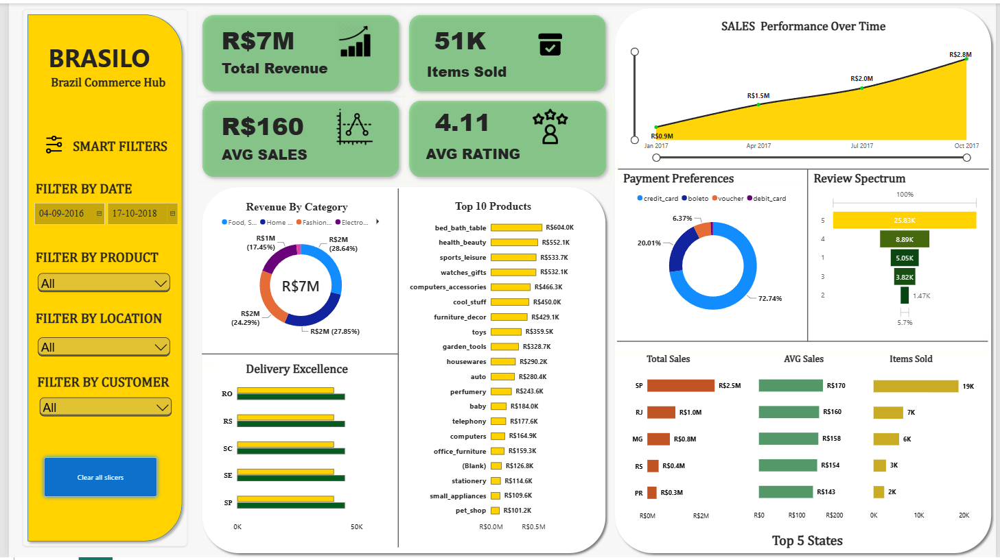

# 📊 Olist E-Commerce – Power BI Dashboard

## Dashboard Overview

An interactive Power BI dashboard developed using the Brazilian Olist E-Commerce dataset to analyze sales performance and explore meaningful business insights.

The dashboard presents e-commerce data through interactive visualizations, helping users understand business performance and identify important trends.

### Live Interactive Dashboard

**Click the dashboard preview below to explore the interactive Power BI report.**

### Dashboard File

The Power BI Desktop file is available in the main project repository:

`olist_powerbi_dashboard.pbix`

Download the file and open it using Microsoft Power BI Desktop.

### Tools Used

- Microsoft Power BI
- Power Query
- DAX
- Data Visualization

### Project Repository

[View the complete Olist ETL Project on GitHub](https://github.com/Antonyremay/olist-etl-project)

**Note:** Access to the interactive dashboard may require signing in with a Power BI account that has permission to view the report.
