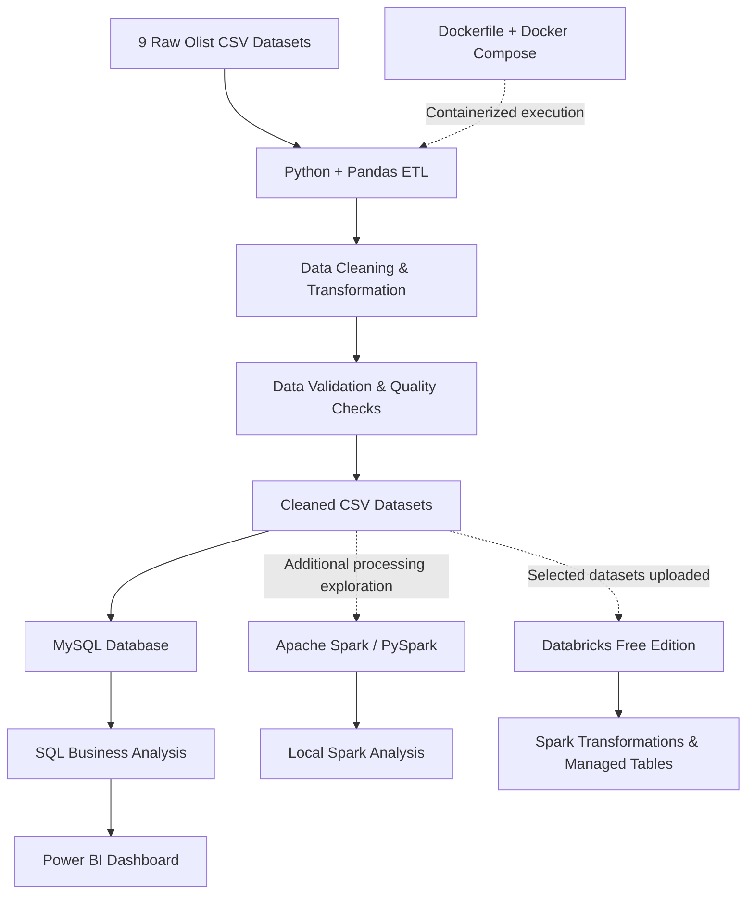
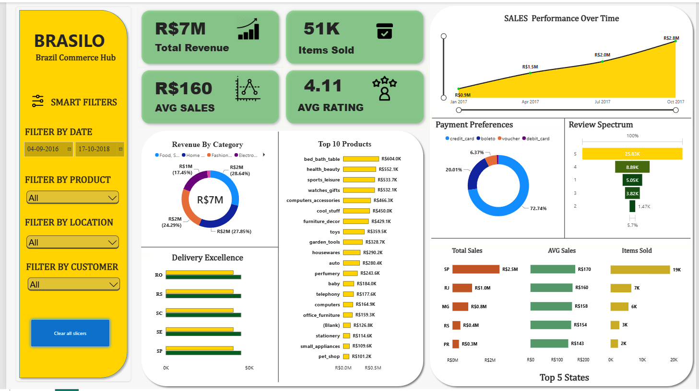

# Olist E-Commerce ETL Pipeline & Sales Insights

An end-to-end data engineering and analytics project built using the Brazilian Olist E-Commerce Public Dataset. The project demonstrates data extraction, transformation, cleaning, validation, database integration, containerization, distributed data processing exploration, SQL analysis, and business intelligence reporting.

The primary ETL pipeline is developed using **Python, Pandas, and MySQL**, with **Docker and Docker Compose** for containerization. Additional big-data processing experiments are implemented using **Apache Spark, PySpark, and Databricks Free Edition**. Power BI is used to present business insights through an interactive dashboard.

---

## Project Overview

The objective of this project is to transform raw e-commerce datasets into structured, validated data that can be used for database management, analytical processing, and business intelligence.

### Project Highlights

- Processed nine Brazilian e-commerce datasets using Python and Pandas.
- Performed data cleaning, transformation, standardization, and validation.
- Loaded cleaned datasets into MySQL using SQLAlchemy and PyMySQL.
- Containerized the ETL environment using Docker and Docker Compose.
- Explored distributed data processing using Apache Spark and PySpark.
- Performed additional Spark-based analysis using Databricks Free Edition.
- Executed SQL queries to investigate business questions and sales performance.
- Developed an interactive Power BI dashboard for sales insights.

---

## Technologies & Tools

| Category | Technologies |
|---|---|
| Programming Language | Python |
| Data Processing | Pandas, NumPy |
| Database | MySQL |
| Database Connectivity | SQLAlchemy, PyMySQL |
| Containerization | Docker, Docker Compose |
| Big Data Processing | Apache Spark, PySpark |
| Cloud Data Platform | Databricks Free Edition |
| Query Language | SQL |
| Data Visualization | Power BI |
| Development Environment | VS Code |
| Version Control | Git, GitHub |

---

## Project Architecture

The project consists of a primary Python-based ETL workflow, followed by database analysis and business intelligence reporting. Local PySpark and Databricks workflows provide additional distributed-processing experience.

### End-to-End Workflow



### Architecture Components

1. **Data Extraction:** Load the original Olist CSV datasets.
2. **Data Transformation:** Clean, standardize, and transform datasets using Python and Pandas.
3. **Data Validation:** Check missing values, duplicates, data types, and data consistency.
4. **Database Loading:** Load the processed datasets into MySQL.
5. **Containerization:** Package the ETL application and dependencies using Docker.
6. **Big Data Exploration:** Read, filter, aggregate, and join datasets using local Apache Spark and PySpark.
7. **Databricks Analysis:** Perform additional Spark transformations and create managed tables in Databricks.
8. **SQL Analysis:** Execute business-oriented queries and extract insights.
9. **Visualization:** Present analytical results through an interactive Power BI dashboard.

---

## Dataset Information

The project uses the Brazilian Olist E-Commerce Public Dataset, containing information about customers, orders, products, sellers, payments, reviews, and geolocation.

### Nine Datasets Used

1. Customers
2. Geolocation
3. Orders
4. Order Items
5. Order Payments
6. Products
7. Product Category Translation
8. Reviews
9. Sellers

### Processed Dataset Summary

| Dataset | Cleaned Records |
|---|---:|
| Geolocation | 738,332 |
| Orders | 99,441 |
| Order Items | 112,650 |
| Order Payments | 103,886 |
| Customers | 99,441 |
| Products | 32,951 |
| Reviews | 99,224 |
| Sellers | 3,095 |
| Category Translation | 71 |
| **Total** | **1,296,091** |

*The original and cleaned CSV datasets are maintained locally and excluded from Git tracking to avoid uploading large data files.*

---

## 1. Python & Pandas – ETL Pipeline

Developed individual Python scripts to process the nine Olist datasets.

### Key Operations

- Loaded CSV files using Pandas.
- Inspected dataset structures, shapes, and data types.
- Identified missing values and duplicate records.
- Handled data inconsistencies and invalid records.
- Standardized data formats and column values.
- Performed data validation after cleaning.
- Exported cleaned datasets for further processing.

### ETL Workflow

**Extract → Transform → Validate → Load**

The cleaned datasets were prepared for MySQL database integration and subsequent analysis.

---

## 2. MySQL – Database Integration

Integrated the cleaned datasets with a MySQL database to store structured data for querying and analysis.

### Tools Used

- MySQL
- SQLAlchemy
- PyMySQL
- Python dotenv

### Work Completed

- Established a Python-to-MySQL database connection.
- Loaded the cleaned datasets into MySQL tables.
- Used SQLAlchemy for database interaction.
- Managed database configuration through environment variables.
- Verified the loaded tables and record counts.

Sensitive database credentials are maintained in a local `.env` file and are not included in the repository.

---

## 3. Docker – Containerization

Containerized the ETL environment to make the application and its dependencies easier to reproduce.

### Tools Used

- Docker Desktop
- Dockerfile
- Docker Compose
- Docker Hub

### Work Completed

- Created a Dockerfile using a Python base image.
- Configured the project dependencies through `requirements.txt`.
- Built the Docker image.
- Created a Docker Compose configuration for the application and MySQL test database.
- Executed the ETL application in the containerized environment.
- Verified database table creation and record counts.
- Built and pushed the Docker image to Docker Hub.

**Docker Hub:** https://hub.docker.com/r/remayy/olist-etl

**Important:** The Docker workflow uses a separate test database named `olist_ecommerce_docker_test`. The database loader uses table replacement behavior, so verify the destination database before running it.

---

## 4. Apache Spark & PySpark – Big Data Processing

Implemented separate PySpark scripts to explore distributed data processing using Apache Spark.

### Environment

- Apache Spark 4.3.0
- PySpark
- Python 3.13
- Java 21
- VS Code

### PySpark Implementations

**01 – Read Order Items**

- Loaded the cleaned order items dataset into a Spark DataFrame.
- Inspected the schema and data types.
- Verified the dataset record count.

Result: **112,650 records.**

**02 – Order Items Data Quality**

- Checked for missing values.
- Identified duplicate records.
- Performed basic data quality validation.

Result: **112,650 records, zero null values, and zero exact duplicate records.**

**03 – Seller Sales Analysis**

- Grouped order item records by seller.
- Calculated seller-level sales and item counts.
- Sorted sellers based on sales performance.

Example result:

| Metric | Value |
|---|---:|
| Top Seller ID | `4869f7a5dfa277a7dca6462dcf3b52b2` |
| Total Sales | 229,472.63 |
| Items Sold | 1,156 |
| Total Product Sales | 13,591,643.70 |
| Total Freight Value | 2,251,909.54 |

**04 – Orders and Order Items Join**

- Loaded the orders and order items datasets.
- Joined both DataFrames using `order_id`.
- Verified the resulting record count.

| Dataset | Records |
|---|---:|
| Orders | 99,441 |
| Order Items | 112,650 |
| Joined Dataset | 112,650 |

**Execution Environment:** Local Spark using `local[*]` mode.

These scripts represent additional Spark-based processing exercises, separate from the primary Python/Pandas ETL pipeline.

---

## 5. Databricks – PySpark Analysis

Used Databricks Free Edition to perform additional Spark-based data processing and analysis in a hosted notebook environment.

### Work Completed

- Created a Databricks workspace.
- Created a Unity Catalog managed volume for dataset storage.
- Uploaded the cleaned orders and order items CSV files.
- Read the uploaded datasets into Spark DataFrames.
- Applied filtering and aggregation operations.
- Performed seller-level sales analysis.
- Joined orders and order items datasets.
- Created and saved managed tables.
- Executed SQL queries to validate the results.

### Managed Tables Created

| Table | Description |
|---|---|
| `workspace.default.olist_seller_sales` | Aggregated seller sales analysis |
| `workspace.default.olist_orders_items` | Joined orders and order items data |

### Validation Results

- Orders DataFrame: 99,441 records.
- Order Items DataFrame: 112,650 records.
- Joined DataFrame: 112,650 records.

The Databricks notebook is available at:

`databricks_notebooks/Olist_PySpark_Analysis.py`

---

## 6. SQL – Business Analysis

Used SQL to explore the structured e-commerce data and answer business-related questions.

The analysis focuses on:

- Seller sales performance.
- Product and order analysis.
- Revenue-related metrics.
- Order and payment information.
- Customer and seller relationships.
- Business insights derived from joined datasets.

---

## 7. Power BI Dashboard – Olist Sales Insights

Developed an interactive Power BI dashboard using Olist e-commerce data to present business insights through visual reports.

**Click the dashboard preview below to open the interactive report in Power BI Service.**

[](https://app.powerbi.com/groups/me/reports/c096857c-3910-4e23-901a-2f6556dbb002/d982d4f260193c407630?experience=power-bi)

**Power BI Desktop File:** `olist_powerbi_dashboard.pbix`

The `.pbix` file is included in this repository and can be downloaded and opened using Microsoft Power BI Desktop.

*Note: Access to the interactive Power BI report may require signing in with an account that has permission to view it.*

---

## Repository Structure

```text
olist-etl-project/
│
├── Data_sets/
│   ├── Olist_Dataset/
│   └── Cleaned_Dataset/
│
├── python_scripts/
│   ├── customer_data.py
│   ├── geo_map.py
│   ├── items_data.py
│   ├── load_data_to_mysql.py
│   ├── olist_order.py
│   ├── order_payments.py
│   ├── products_data.py
│   ├── prod_category_translate_data.py
│   ├── reviews_data.py
│   └── sellers_data.py
│
├── pyspark_scripts/
│   ├── 01_read_order_items.py
│   ├── 02_order_items_quality.py
│   ├── 03_seller_sales_analysis.py
│   └── 04_orders_items_join.py
│
├── databricks_notebooks/
│   └── Olist_PySpark_Analysis.py
│
├── SQL_queries/
│
├── images/
│   └── Olist_dashboard_image.png
│
├── olist_powerbi_dashboard.pbix
├── requirements.txt
├── Dockerfile
├── compose.yaml
├── .dockerignore
├── .gitignore
└── README.md
```

*The structure represents the local project organization. Raw datasets, cleaned datasets, virtual environments, and sensitive configuration files are excluded from Git tracking.*

---

## Getting Started

### Prerequisites

Install the following tools to work with the project:

- Python
- MySQL
- Git
- Docker Desktop
- Java 21 (for the local PySpark environment)
- Power BI Desktop (to open the dashboard)

*Java is required for the local Spark environment, not for the Docker-based Python ETL application.*

### Clone the Repository

```bash
git clone https://github.com/Antonyremay/olist-etl-project.git
```

```bash
cd olist-etl-project
```

### Python Environment Setup

Create a virtual environment:

```bash
python -m venv .venv
```

Activate the environment on Windows:

```powershell
.\.venv\Scripts\Activate.ps1
```

Install the required dependencies:

```bash
pip install -r requirements.txt
```

*The original and cleaned Olist datasets must be obtained separately and placed in their expected project directories. Configure the local database connection before running the MySQL loading workflow.*

For Docker-specific execution instructions, refer to the Docker section and the project repository configuration.

---

## Future Enhancements

- Automate the ETL pipeline.
- Explore incremental data loading.
- Implement additional Spark transformations and analytical workflows.
- Improve data quality monitoring.
- Extend business reporting and dashboard analysis.

---

## Author

**Antony Remane**

Computer Science Graduate | Aspiring Data Engineer

- **GitHub:** https://github.com/Antonyremay
- **Project Repository:** https://github.com/Antonyremay/olist-etl-project
- **Docker Hub:** https://hub.docker.com/r/remayy/olist-etl

---

## License

This project is licensed under the MIT License. See the `LICENSE` file for details.
